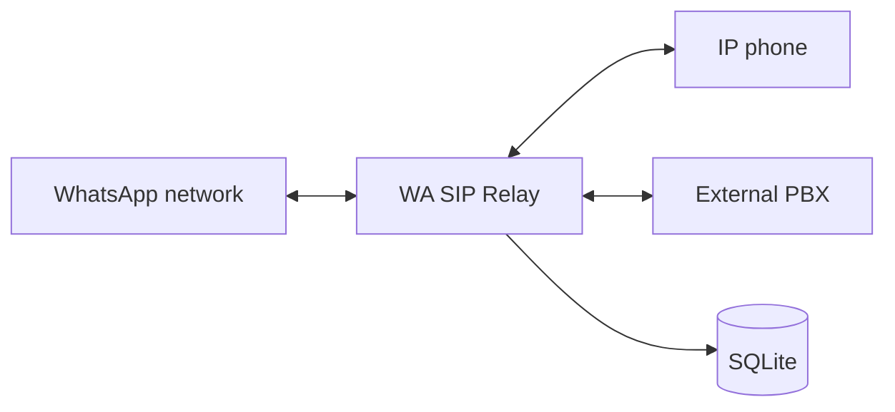

# WA SIP Relay

WA SIP Relay connects multiple WhatsApp accounts to SIP phones or an external
PBX. It contains its own SIP registrar, RTP media bridge, administration panel,
persistent per-account call history, and remote phonebook feeds.



## Supported scope

- Multiple linked WhatsApp accounts with isolated SIP identities.
- Incoming WhatsApp voice calls to SIP.
- Outgoing SIP voice calls to WhatsApp numbers.
- Direct SIP registration for an IP phone or softphone.
- Registration as an extension on Asterisk, FreePBX, 3CX, or another SIP PBX.
- PCMU and PCMA audio with RFC 4733 telephone events.
- Persistent call history for calls handled by the relay.
- Grandstream XML, vCard, and JSON phonebook feeds.
- Registered SIP endpoint inventory with client name and source IP.
- English and Indonesian administration UI.
- Linux amd64 and arm64 Docker images.

## Storage

The relay uses one SQLite database by default:

```text
data/wa-sip-relay.db
```

The database contains every linked WhatsApp device, relay configuration, SIP
credential, contact used by WhatsApp, and per-account call history.

SQLite runs with foreign keys, a five-second busy timeout, and WAL mode. Keep the
database on a local Linux filesystem. Do not place it on NFS, SMB, or another
network filesystem.

## Requirements

- Linux host, including Debian, Ubuntu, Armbian, or WSL2.
- Docker Engine with the Compose plugin.
- A fixed LAN address or DHCP reservation for the host.
- One or more WhatsApp accounts dedicated to testing.
- An IP phone or PBX reachable from the host over the LAN.

## Quick start with Docker Compose

### 1. Clone the project

```bash
git clone https://github.com/FoxLost/wa-sip-relay.git
cd wa-sip-relay
```

### 2. Create the runtime configuration

```bash
cp .env.example .env
mkdir -p data
chmod 700 data
openssl rand -hex 32
```

Put the generated value in `WACALLS_API_KEY` inside `.env`. Set a different
password of at least eight characters in `WACALLS_WEBUI_PASSWORD`; this is the
credential entered on the administration sign-in page. Set `WACALLS_PUBLIC_IP`
to the host's LAN address, not `127.0.0.1` and not the container address.

Example:

```dotenv
WACALLS_API_KEY=replace-with-the-generated-secret
WACALLS_WEBUI_PASSWORD=replace-with-a-different-admin-password
WACALLS_PUBLIC_IP=192.168.1.10
WACALLS_SIP_ADDR=0.0.0.0:5060
WACALLS_SIP_ADVERTISE_PORT=5060
WACALLS_RTP_PORT_MIN=40000
WACALLS_RTP_PORT_MAX=40049
WACALLS_MAX_ACCOUNTS=5
WACALLS_MAX_CALLS=1
```

### 3. Build and start

```bash
docker compose up -d --build
docker compose ps
docker compose logs -f relay
```

The first build compiles the native WhatsApp MLow codec and can take several
minutes. Later builds use Docker's cache.

### 4. Check the server

```bash
set -a
. ./.env
set +a
curl -fsS -H "X-API-Key: $WACALLS_API_KEY" http://127.0.0.1:8080/livez
curl -fsS -H "X-API-Key: $WACALLS_API_KEY" http://127.0.0.1:8080/readyz
```

Open:

```text
http://HOST_LAN_IP:8080
```

Enter the administration password from `WACALLS_WEBUI_PASSWORD` on the sign-in page.

## Network requirements

The supplied Compose file publishes the SIP and RTP ports one-to-one. This works
with native Linux, WSL2, and Docker Desktop without Docker host networking.

| Purpose | Protocol | Default |
|---|---|---:|
| Administration UI and API | TCP | 8080 |
| SIP signaling | UDP and TCP | 5060 |
| RTP audio | UDP | 40000–40049 |

Allow these ports only from the trusted LAN or voice VLAN. Never expose SIP, RTP,
the administration UI, or the SQLite files directly to the internet.

### WSL2 mirrored networking

Use the Windows machine's LAN address as `WACALLS_PUBLIC_IP`. With mirrored
networking, published Docker ports are reachable through that address after the
corresponding Windows Firewall rules are enabled.

Windows Firewall must allow TCP 8080, TCP/UDP 5060, and UDP 40000–40049 from the
local LAN. Confirm that no Windows or WSL service already occupies those ports:

```bash
ss -lntup | grep -E ':(5060|8080)\b'
```

## Link WhatsApp accounts

1. Open the administration panel.
2. Select **Add account** and enter a recognizable name.
3. Select the account and choose **Pair**.
4. On the phone, open **WhatsApp → Linked devices → Link a device**.
5. Scan that account's QR code.
6. Wait until the panel displays **WhatsApp connected**.
7. Repeat for each additional account.

All linked devices are stored in `data/wa-sip-relay.db` and restored independently
after a normal restart. Deleting an account removes only that account's local
WhatsApp device, SIP configuration, call history, and related data.

The default maximum is five accounts. Change `WACALLS_MAX_ACCOUNTS` only after
testing memory use and concurrent media load on the target host. Do not run two
relay containers against the same SQLite file.

## Direct IP-phone setup

Select the WhatsApp account, then open **SIP → PBX registers here**. Every account
starts with a generated SIP username and password. Both fields can be customized
and saved from this panel; usernames must remain unique across accounts.
Configure the phone:

| Phone setting | Value |
|---|---|
| SIP server / registrar | Relay LAN address |
| SIP port | 5060 |
| SIP user ID | Username shown by the relay |
| Authentication ID | Same SIP username |
| Password | Password shown by the relay |
| Transport | UDP first |
| Preferred codec 1 | PCMU |
| Preferred codec 2 | PCMA |
| Registration | Enabled |

Changing a SIP username or password removes that account's current registrations.
Update the phone or PBX with both saved values and register it again.


Dial WhatsApp destinations in international format without `+`, spaces, or a
dial-out prefix:

```text
628123456789
```

Do not add prefix `9` unless the PBX removes it before sending the SIP INVITE.

## Incoming WhatsApp calls

An incoming WhatsApp call rings the currently registered direct SIP endpoint.
The relay accepts the WhatsApp call only after the SIP endpoint answers.

If an incoming call is rejected immediately:

1. Confirm the panel shows a registered SIP endpoint.
2. Confirm the phone's SIP contact is reachable from the relay host.
3. Keep PCMU and PCMA at the top of the phone's codec list.
4. Confirm UDP 5060 and the RTP range are allowed in both directions.
5. Check `docker compose logs --since=5m relay`.

One active call per WhatsApp account is enabled by default. Separate accounts can
handle calls concurrently.

## External PBX mode

Use **SIP → Register with PBX** when the relay must register as an extension on
an existing PBX.

Configure:

- PBX host and port.
- Extension username.
- Authentication ID when different from the extension.
- Extension password.
- Optional outbound proxy.
- Destination extension or queue for incoming WhatsApp calls.

Routing behavior:

- **PBX → WhatsApp:** route the call through the extension registered by the
  intended WhatsApp account and send the destination in international format.
- **WhatsApp → PBX:** the relay calls that account's configured destination
  extension or queue.

Give every account a unique PBX extension. If multiple relay accounts use the
same PBX address and the destination does not identify the extension, add
`X-WA-SIP-Account` with the account's session ID or PBX extension. Ambiguous
calls are rejected instead of being sent through another account.

External-PBX mode disables direct phone registration for that account.

## Codec policy

WhatsApp calls use MLow audio. SIP audio therefore requires transcoding.

WA SIP Relay advertises PCMU and PCMA because both codecs are broadly supported,
royalty-free, and inexpensive to transcode. G.723.1, G.729, iLBC, G.726, Opus,
and G.722 are deliberately not advertised. Advertising a codec without a tested
encoder and decoder causes silent or one-way audio.

Use PBX transcoding when an endpoint cannot use PCMU or PCMA.

## Call history

Completed incoming and outgoing relay calls are stored per account in SQLite and
shown for the selected account in **Call history**. The authenticated API is:

```text
GET /api/sessions/{sessionId}/history
```

The history starts when the relay is installed. WhatsApp does not expose the
account's old native call log, so earlier calls cannot be imported.

## Phonebook feeds

The relay exports contacts from the selected WhatsApp account that have a
resolved telephone number. Unresolved LID-only identities are excluded.

The panel provides tokenized URLs for:

```text
/phonebook/{sessionId}/grandstream.xml?token=...
/phonebook/{sessionId}/contacts.vcf?token=...
/phonebook/{sessionId}/contacts.json?token=...
```

Use the Grandstream XML URL as the phone's remote phonebook URL. Treat the feed
token as a password. Regenerating `WACALLS_API_KEY` invalidates existing
phonebook URLs.

## SQLite backup and restore

Stop the relay before copying the database so the WAL is checkpointed:

```bash
docker compose stop relay
tar -czf "wa-sip-relay-backup-$(date +%F-%H%M%S).tar.gz" data/
docker compose start relay
```

Restore:

```bash
docker compose down
mv data "data.before-restore-$(date +%s)"
mkdir data
tar -xzf wa-sip-relay-backup-YYYY-MM-DD-HHMMSS.tar.gz
docker compose up -d
```

Protect backups: the database contains WhatsApp device credentials and SIP
passwords.

## Updating

Source build:

```bash
git pull --ff-only
docker compose up -d --build
```

Published image:

```bash
docker compose pull
docker compose up -d
```

Back up `data/` before upgrading. The first multi-account release automatically
migrates the former singleton session table while preserving the linked account,
SIP credentials, history, and WhatsApp device.

## Troubleshooting

### The UI does not open

```bash
docker compose ps
docker compose logs --tail=200 relay
curl -v http://127.0.0.1:8080/livez
```

Check TCP 8080 and confirm both `WACALLS_API_KEY` and `WACALLS_WEBUI_PASSWORD` are set.

### The phone does not register

- Confirm its SIP server is the relay LAN address.
- Confirm username, Authentication ID, and password match the panel.
- Check UDP 5060 reachability and device time.
- Ensure another SIP service is not already using port 5060.

### Calls connect but audio is missing

- Put PCMU first and PCMA second.
- Verify `WACALLS_PUBLIC_IP` is the host LAN address.
- Allow UDP 40000–40049 in both directions.
- Disable SIP ALG on the router when it rewrites LAN SIP packets.
- Capture signaling only on a trusted host; SIP credentials are not encrypted.

### SQLite reports `database is locked`

- Confirm only one relay process uses the database.
- Keep `data/` on a local filesystem.
- Do not copy a live database without stopping the relay.

### Pairing disappears after restart

- Confirm `./data:/app/data` is mounted.
- Confirm `data/wa-sip-relay.db` exists and is writable.
- Check whether WhatsApp removed the linked device from the phone.

## Development

```bash
go test ./cmd/server ./internal/voip/call
npm --prefix client ci
npm --prefix client run build
docker build -t wa-sip-relay:local .
```

Live audio requires cgo, the `mlow` build tag, and the native `opus_mlow`
library. The Dockerfile fetches a pinned codec revision and provides reproducible
amd64 and arm64 media builds.

## Security

- `WACALLS_API_KEY` is mandatory and grants integration/API administration
  access to every configured account.
- `WACALLS_WEBUI_PASSWORD` is mandatory, grants the same administrative scope,
  and is used by the browser panel instead of exposing the integration API key.
- Use different random values for the API key and Web UI password.
- SIP uses plain UDP/TCP and digest authentication.
- RTP is unencrypted.
- Restrict all service ports to a trusted LAN or VPN.
- Do not commit `.env`, `data/`, logs, packet captures, or backups.
- Use a dedicated WhatsApp account for testing unofficial integration.

## License and upstream

WA SIP Relay is derived from
[AstraCalls](https://github.com/AstraOnlineWeb/AstraCalls) and keeps its WhatsApp
signaling and MLow media implementation. The service is distributed under
GNU AGPL-3.0. The original WaCalls MIT notice is preserved in
[`LICENSE.WaCalls`](LICENSE.WaCalls).

This repository is independent and is not an official AstraCalls distribution.
